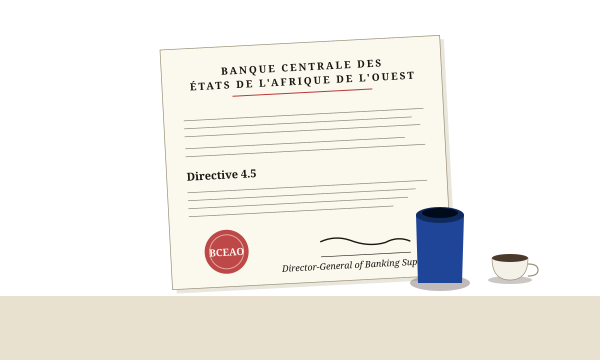

# §1.1 The Q3 letter

The envelope arrived on a Tuesday in September, on letterhead Amina Bello recognized before she read the return address. The Central Bank of West African States — *Banque Centrale des États de l'Afrique de l'Ouest* — wrote to commercial banks the way doctors wrote to patients: in clear language, without exclamation, in matters that did not invite contestation.

The letter ran two pages. Directive 4.5, the body began, would take effect on the fourteenth of November. Penalty caps on consumer credit lines would be reduced from twenty percent to sixteen. Commercial banks in WAEMU member states were to file their compliance position by the thirtieth of October. The Director-General of Banking Supervision signed at the bottom in deep ink.

Amina put the letter on her desk and made the morning's first cup of coffee.

> **WAEMU.** The West African Economic and Monetary Union. Eight member states sharing the CFA franc as their common currency: Benin, Burkina Faso, Côte d'Ivoire, Guinea-Bissau, Mali, Niger, Senegal, and Togo. The BCEAO is its central bank.

Six weeks. The penalty-cap change touched fourteen loan products at Sonibank Niger. Each product had its own pricing formula, its own risk model, its own credit-decision rules and its own boilerplate language in the customer contract. Each product talked to a half-dozen modules in the codebase. The cascade ran further out: into the late-payment hooks, into the reporting that fed the risk committee, into the templates that produced the quarterly attestation. Touch the penalty cap and the whole organism noticed.

Six weeks ago, before Amina would have called this work hard. Today, with the team's writing capacity what it had become — agents helping at every turn, code flowing through the modules faster than any one person could read it line by line — the work itself was no longer the obstacle. The obstacle was different.

The obstacle was knowing — at the moment of writing each change — what else moved.

This is the story of the discipline a small bank in Niamey developed to answer that question, and why what they built happened to also be the discipline the broader software industry was about to need.

· · ·

## An ordinary morning, an ordinary letter

The letter was not exceptional. The Central Bank wrote three or four such letters a year. Each one moved a small number — a cap, a ratio, a reporting threshold — and each one rippled through the codebases of every commercial bank in the eight WAEMU member states. Compliance officers were used to it. Programmers were used to it. The auditors who visited every three years were especially used to it.
