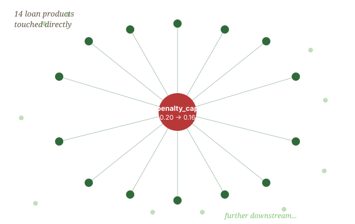

# §1.2 What was new

What was new was not the letter. What was new was the speed at which the code changed — and the difficulty of seeing, at the moment of changing it, what the change would cost.

A year earlier, when a directive like this arrived, the programming team at Sonibank Niger would have estimated three weeks of careful work: read the directive, list the affected modules, write the changes by hand, test them against the previous quarter's transactions, push to staging, schedule a review with the compliance officer, push to production. Three weeks, sometimes four.

The letter that arrived on this Tuesday could be handled, technically, in two days. The agents on the team could produce all the necessary code changes by Thursday evening. The tests would pass. The build would compile.

And then someone would have to know whether all of it was *correct*.

> **Cascade.** The set of consequences a single change implies. In a small bank under regulatory scrutiny, it is the question every change must answer.
